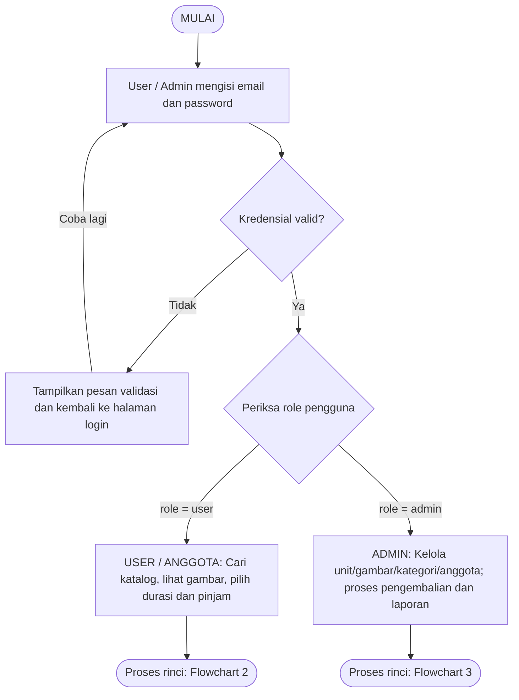
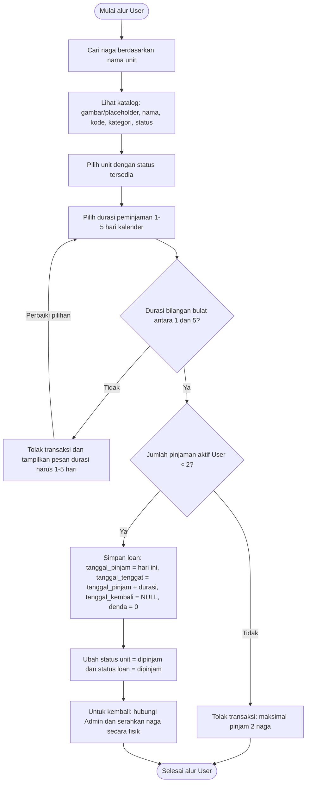
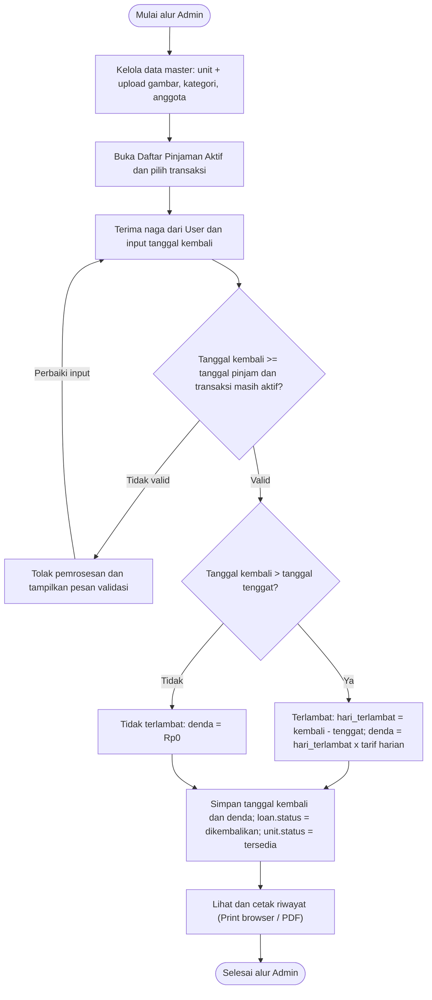
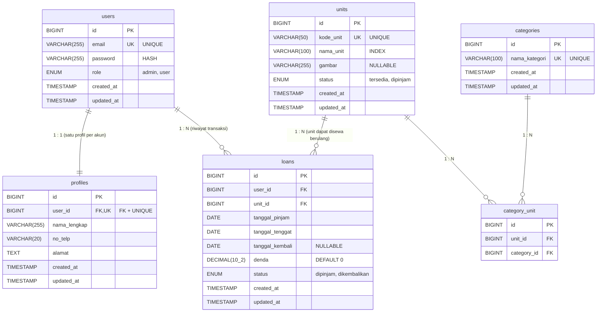

# DRACORENT — Flowchart & Entity Relationship Diagram (ERD)

> **Dokumentasi Visual Alur Sistem dan Skema Relasi 6 Tabel Database — Sistem Rental Naga (DracoRent)**
>
> Berkas PDF sumber: [docs/DracoRent_Flowchart_ERD.pdf](./docs/DracoRent_Flowchart_ERD.pdf)

---

## 1. Flowchart 1 — Login dan Pemilihan Role

---

## 2. Flowchart 2 — Alur Peminjaman User / Anggota

---

## 3. Flowchart 3 — Pengelolaan dan Pengembalian Admin

---

## 4. Entity Relationship Diagram (ERD) — 6 Tabel

### Gambar Skema Database

### Diagram ER (Mermaid)

---

## 5. Detail Kardinalitas Relasi
1. **`users` ↔ `profiles` (`1 : 1`)**: Satu akun pengguna tepat memiliki satu profil (`profiles.user_id` memiliki constraint `FOREIGN KEY` sekaligus `UNIQUE`).
2. **`users` ↔ `loans` (`1 : N`)**: Satu pengguna dapat memiliki banyak riwayat transaksi peminjaman, namun dibatasi maksimal **2 pinjaman berstatus `dipinjam`** pada saat bersamaan.
3. **`units` ↔ `loans` (`1 : N`)**: Satu unit naga dapat disewa berulang kali dari waktu ke waktu, tetapi hanya boleh berada pada maksimal **1 transaksi berstatus `dipinjam`** pada satu waktu.
4. **`units` ↔ `categories` (`M : N` via `category_unit`)**: Satu unit naga dapat memiliki lebih dari satu kategori, dan satu kategori dapat dimiliki oleh banyak unit naga melalui tabel pivot `category_unit` (`UNIQUE(unit_id, category_id)`).
