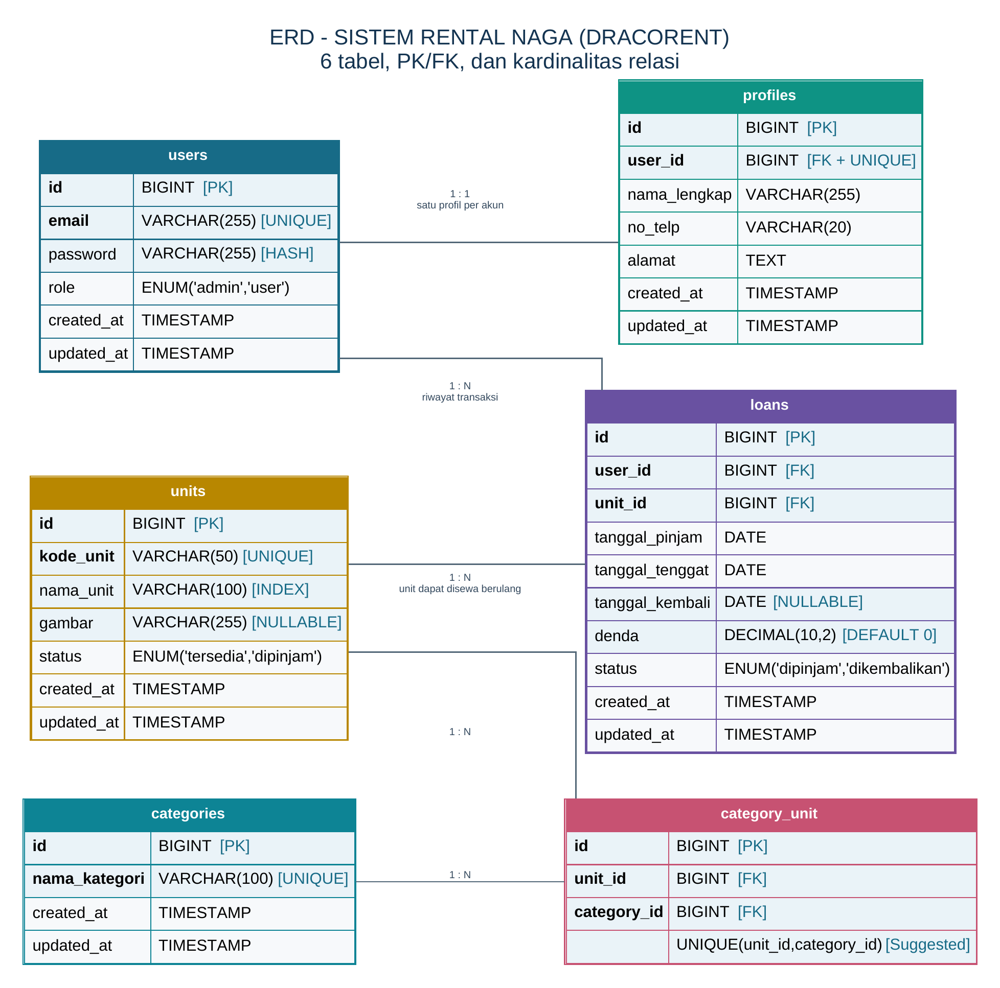

# DracoRent — Sistem Rental Naga (Sertifikasi WebDev)

> **Aplikasi Pengelolaan Inventaris & Peminjaman Unit Naga Berbasis Role (Admin & User/Anggota)**

---

## 1. Dokumen Spesifikasi Proyek (Markdown & PDF)

Seluruh dokumen perancangan resmi proyek **DracoRent (Versi 1.1)** tersedia dalam format Markdown maupun PDF:

| Dokumen | Versi Markdown (`.md`) | Versi PDF (`.pdf`) | Deskripsi |
| :--- | :--- | :--- | :--- |
| **Business Requirement Document (BRD)** | [DracoRent_BRD.md](./DracoRent_BRD.md) | [docs/DracoRent_BRD.pdf](./docs/DracoRent_BRD.pdf) | Latar belakang, tujuan bisnis, ruang lingkup, *Business Rules* (`BR-01` s/d `BR-11`), rancangan relasi data, dan kebutuhan nonfungsional. |
| **Product Requirement Document (PRD)** | [DracoRent_PRD.md](./DracoRent_PRD.md) | [docs/DracoRent_PRD.pdf](./docs/DracoRent_PRD.pdf) | Matriks hak akses, spesifikasi fitur `F-01` s/d `F-09`, validasi server-side, dan kriteria penerimaan (`AC-01` s/d `AC-34`). |
| **Flowchart & ERD (6 Tabel)** | [DracoRent_Flowchart_ERD.md](./DracoRent_Flowchart_ERD.md) | [docs/DracoRent_Flowchart_ERD.pdf](./docs/DracoRent_Flowchart_ERD.pdf) | Flowchart Login & Pemilihan Role, Flowchart Peminjaman User, Flowchart Pengembalian Admin, serta ERD 6 Tabel. |
| **Laporan Hasil UAT (Test Results)** | [DracoRent_UAT_Results.md](./DracoRent_UAT_Results.md) | [docs/DracoRent_UAT_Results.md](./docs/DracoRent_UAT_Results.md) | Hasil eksekusi 34 kasus uji (`AC-01` s/d `AC-34`), RTM, log temuan, dan matriks *sign-off* kelulusan 100%. |
| **Dokumentasi Proyek (Project Doc)** | [DracoRent_Project_Documentation.md](./DracoRent_Project_Documentation.md) | [docs/DracoRent_Project_Documentation.md](./docs/DracoRent_Project_Documentation.md) | Arsitektur sistem, skema 6 tabel ERD, spesifikasi REST API, keamanan Bcrypt & PDO, serta panduan deployment. |
| **Buku Panduan Pengguna (Manual Book)** | [DracoRent_Manual_Book.md](./DracoRent_Manual_Book.md) | [docs/DracoRent_Manual_Book.md](./docs/DracoRent_Manual_Book.md) | Buku panduan pengguna lengkap (Manual Book) untuk Admin Kurator dan Anggota Serikat (6 Bab terstruktur). |
| **Galeri Screenshots & Bukti UAT** | [screenshots/README.md](./screenshots/README.md) | [docs/screenshots/](./docs/screenshots/) | 18 berkas tangkapan layar (14 layar terverifikasi unik), skema ERD, bukti UAT, dan video animasi pengujian. |

---

## 2. Nama & Deskripsi Project

**DracoRent: Sistem Rental Naga**  
DracoRent adalah aplikasi web pengelolaan inventaris dan peminjaman unit naga yang dikelola oleh **Admin (Pengelola Kandang)** dan digunakan oleh **User (Anggota)**. Naga dapat disewa untuk berbagai kebutuhan seperti transportasi berat, patroli udara, eskor & tempur, maupun ekspedisi. Setiap unit naga memiliki `kode_unit` unik, dapat dikelompokkan ke dalam beberapa kategori (*many-to-many*), dan dilengkapi foto spesimen.

---

## 3. Daftar Fitur Utama (`F-01` s/d `F-09`)

### Umum
- **Autentikasi & Otorisasi Role (`F-01`)**: Login dan logout wajib untuk mengakses halaman terproteksi. Mendukung dua role pengguna: **Admin** dan **User (Anggota)**.
- **Manajemen Profil Tunggal 1:1 (`F-02`)**: Satu akun hanya memiliki tepat satu profil (`nama_lengkap`, `no_telp`, `alamat`), dan setiap pengguna dapat memperbarui profilnya sendiri.

### Admin (Pengelola Kandang)
- **CRUD Kategori Naga (`F-03`)**: Tambah, ubah, dan hapus kategori naga dengan proteksi relasi jika kategori masih terikat pada unit.
- **CRUD Unit Naga, Multiple Kategori & Gambar (`F-04`)**:
  - Satu nama naga (`nama_unit`) boleh sama namun dibedakan melalui `kode_unit` yang wajib unik.
  - Satu unit naga dapat memiliki lebih dari satu kategori (`category_unit`).
  - Mendukung gambar unit naga (`JPG`, `JPEG`, `PNG`, `WEBP` maks 2 MB) atau *placeholder* otomatis.
- **CRUD Data Anggota (`F-05`)**: Mengelola akun anggota beserta profil tunggalnya (`1:1`), dengan proteksi agar riwayat transaksi historis tidak terhapus.
- **Pengembalian Fisik & Kalkulasi Denda (`F-08`)**:
  - Melihat seluruh daftar naga yang sedang dipinjam.
  - Hanya Admin yang dapat memproses pengembalian naga, memvalidasi `tanggal_kembali >= tanggal_pinjam`, serta menghitung denda otomatis jika `tanggal_kembali > tanggal_tenggat`.
- **Riwayat Transaksi & Cetak Laporan (`F-09`)**: Melihat seluruh riwayat peminjaman dari semua anggota dan mencetak laporan via browser print / PDF.

### User (Anggota)
- **Pencarian & Katalog Naga (`F-06`)**: Mencari naga berdasarkan nama unit (`nama_unit`), melihat kategori, foto/placeholder, dan status ketersediaan (`tersedia` / `dipinjam`).
- **Transaksi Pinjam Naga Mandiri (`F-07`)**:
  - Meminjam unit naga yang berstatus `tersedia` dengan pilihan durasi **1 sampai 5 hari kalender**.
  - Batas kuota maksimal **2 pinjaman aktif (`dipinjam`)** per anggota dalam satu waktu.
- **Pinjaman Saya & Riwayat Pribadi (`F-09`)**: Melihat daftar naga yang sedang disewa dan riwayat transaksi milik akun sendiri, serta instruksi menghubungi Admin untuk serah terima pengembalian fisik.

### Aturan Bisnis & Rumus Sistem (`BR-01` s/d `BR-11`)
- **Rumus Tanggal Tenggat**: $\text{Tanggal Tenggat} = \text{Tanggal Pinjam} + \text{Durasi Pilihan (1–5 hari)}$
- **Rumus Hari Terlambat**: $\text{Hari Terlambat} = \max(0, \text{Tanggal Kembali} - \text{Tanggal Tenggat})$
- **Rumus Denda**: $\text{Denda} = \text{Hari Terlambat} \times \text{Tarif Denda Harian}$

---

## 4. Skema Database (ERD 6 Tabel)



| No | Nama Tabel | Primary Key | Foreign Key / Unique | Deskripsi Relasi |
| :-: | :--- | :--- | :--- | :--- |
| 1 | **`users`** | `id` | `email` (`UNIQUE`) | Tabel akun utama (`role`: `admin` / `user`). |
| 2 | **`profiles`** | `id` | `user_id` (`FK` + `UNIQUE`) | Relasi **1:1** dengan `users` (satu profil per akun). |
| 3 | **`units`** | `id` | `kode_unit` (`UNIQUE`), `nama_unit` (`INDEX`) | Data master unit naga (`status`: `tersedia` / `dipinjam`). |
| 4 | **`categories`** | `id` | `nama_kategori` (`UNIQUE`) | Data master kategori naga. |
| 5 | **`category_unit`** | `id` | `unit_id` (`FK`), `category_id` (`FK`) | Tabel pivot relasi **M:N** antara `units` dan `categories`. |
| 6 | **`loans`** | `id` | `user_id` (`FK`), `unit_id` (`FK`) | Transaksi peminjaman & denda (**1:N** dari `users` dan `units`). |

---

## 5. Cara Menjalankan Project (Lokal)

1. Pastikan **MySQL / MariaDB** (Laragon / XAMPP) sudah berjalan.
2. Salin konfigurasi `.env` (opsional jika menggunakan pengaturan default `root` tanpa password):
   ```bash
   cp .env.example .env
   ```
3. Jalankan migrasi & seeder database (6 tabel beserta akun contoh):
   ```bash
   php artisan migrate
   ```
4. Jalankan server aplikasi:
   ```bash
   php artisan serve
   ```
5. Buka di browser: **`http://127.0.0.1:8000`**
   - **Akun Admin**: `admin@dracorent.com` (Password: `123456`)
   - **Akun User**: `user@dracorent.com` (Password: `123456`)
